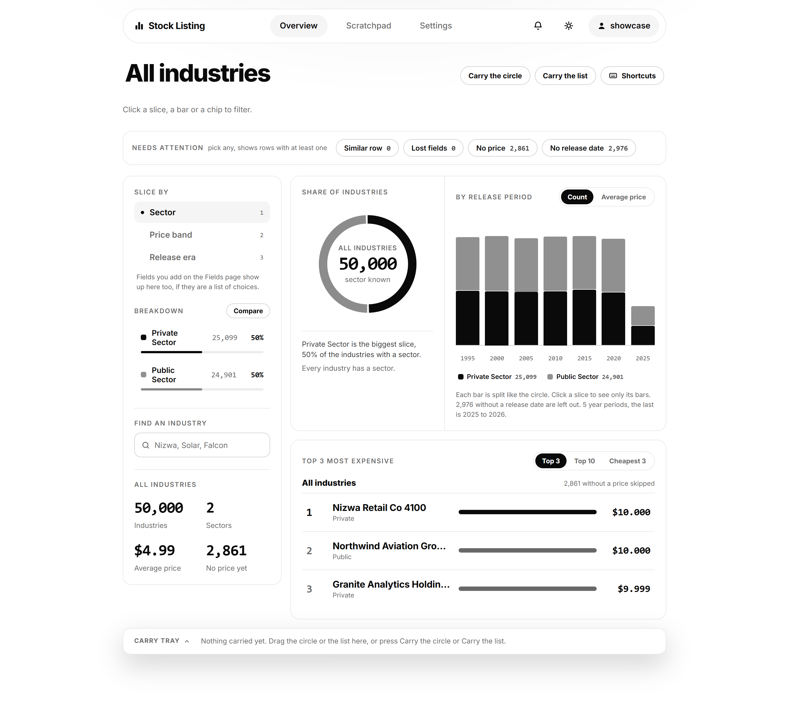
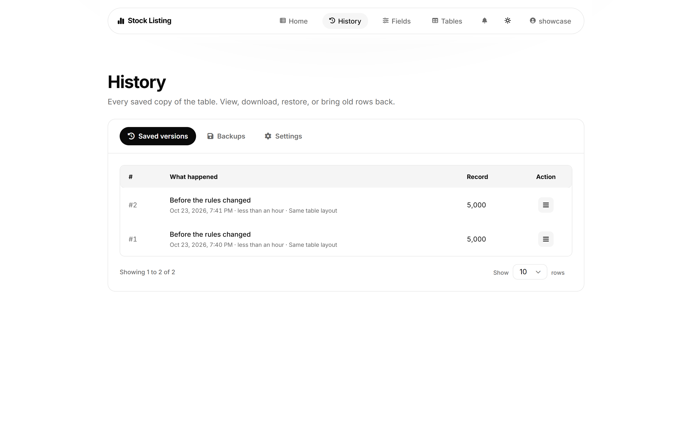

# Industries Manager

Industries Manager is the table our team keeps of industries: names, sectors, prices and release dates. Everyone edits the same table from the browser, and every change is saved as a version, so if someone deletes the wrong rows on a Tuesday, you can put Monday's table back.



It's an Angular 22, .NET 10 API, with PostgreSQL 17 underneath. The API only runs on Windows, because the backups are locked with a key that Windows keeps for your PC.

## Getting started (Windows)

You'll need Windows hence the (Windows), the [.NET 10 SDK](https://dotnet.microsoft.com/download), [Node.js](https://nodejs.org) and [Docker Desktop](https://www.docker.com/products/docker-desktop/). Open Docker Desktop, then:

```bat
git clone https://github.com/icylito/Minimal-API.git
cd Minimal-API\angular
npm ci
cd ..
start.bat
```

`start.bat` brings the database up in Docker and opens two terminal windows, one for the API and one for the angular. Leave both of them open and go to http://localhost:4200.

### Signing in the first time

On its first start the API makes an account called `admin` and prints its password in the API window, once. Copy it, sign in, and you'll be asked to make your new password. One thing that catches people out: double clicking the password usually grabs the full stop after it as well, so check the last character before you paste.

Once you're in, you add everyone else from Settings (if you're the admin) and give each of them a temporary password in which they'd create their own personal password.

### Other ways to start it

| Command | What it's for |
|---|---|
| `start.bat https` | Your PC only, over https |
| `start.bat share` | Lets phones and other PCs on your Wi-Fi open the page |

For `https`, run `dotnet dev-certs https --trust` once beforehand. With `share`, the window prints the address to open on the other device, and the first visit shows a certificate warning that you can continue past.

## Who can do what

Anyone can browse the table without an account. After that it goes up in steps:

| Role | What they can do |
|---|---|
| User | Add, edit and delete rows |
| Manager | All of that, plus the Tables page and backups |
| Admin | Everything, including the fields, History and Settings |

## Made a mistake?

Open **History**, find the version from before the mistake and press **Restore**. We save the table as it is right before restoring, so if you picked the wrong version you can go back from the same page.



Backups are the bigger safety net. One runs every night at 02:00 (or on the next start, if your PC was off), and you can take one yourself from History at any time. Restoring a backup asks you to type `RESTORE`, so nobody does it by accident.

## When something goes wrong

Look at the API window first. It prints what failed and why in a status line, and nearly every fix below starts there.

| What you see | What to do |
|---|---|
| **API offline** or **Could not load the industries** | The API window closed or stopped on an error. Run `start.bat` again. If it complains the address is in use, an old copy is still running somewhere, so close it first a nice trick is to open task manager open details tab look for api_v2 and end the process. |
| **The database isn't reachable, retrying** | Docker Desktop is closed or the database went down. Open Docker Desktop and run `docker compose up -d`. You don't need to restart the API, it reconnects by itself. |
| The page window dies with a missing file or font | Your `node_modules` is missing or out of date. Run `npm ci` in `angular` and start again. |
| **Migration failed** or **Couldn't save a copy before updating the database** | The API window has the full error. Nothing in your data was touched, so fix what it says and restart the API. |
| You lost the admin password | Run `dotnet run --launch-profile http -- --Auth:ResetPassword=admin` in `api_v2`. It prints a new temporary password. Once you're back in, start it normally. |
| **Too many tries. Try again in...** | The message says how long to wait. Each address gets 5 tries a minute, and each username 10 wrong passwords per 15 minutes. |
| **Someone changed this row since you opened it** | A teammate saved the same row first. Reload, see if your change is already there, and make it again if not. |
| **That name is already taken** | Names are compared without case, accents, spaces or symbols, so `Oil & Gas` and `oil gas` count as the same name. |
| **Someone else is changing this right now** | A restore or an import is running. Wait a moment and try again. |
| A backup won't restore | Backups only open on the PC that made them, and not after the table's columns have changed. Keep a copy of the database somewhere else too. |
| Every backup or restore fails | Your Postgres isn't version 17. The one in `docker-compose.yml` is, so use that one. |

## Commands you'll use

**Running the pieces by hand.** If you'd rather not use `start.bat`, start each part yourself. The API comes up on port 5005 and the page on 4200.

```bat
docker compose up -d

cd api_v2
dotnet run --launch-profile http

cd angular
npx ng serve
```

`docker compose down` stops the database and keeps the data. The API reads its database settings from `api_v2/appsettings.Development.json`. To use your own Postgres 17 instead of Docker, copy `appsettings.Development.example.json` to that name and change the two connection strings.

**Building and testing.**

```bat
dotnet build api_v2.slnx
dotnet test api_v2.slnx
dotnet test api_v2.slnx --filter Category!=Smoke

cd angular
npx ng build
npx ng test --watch=false
npm run lint:layers
```

The full `dotnet test` includes a smoke run that needs the Docker database. Add the `--filter` to skip it when the database is down. `lint:layers` checks that the page's folders only import in the allowed direction.

**Changing the database.** Add a migration from `api_v2`. The API applies it on its next start.

```bat
.\migrate.ps1 -Context Data -Name AddSomething
.\migrate.ps1 -Context State -Name AddSomething
```

Use `Data` for the industries, their fields and the Tables page, which a restore can roll back. Use `State` for accounts, settings, notes and the Scratchpad, which always stay as they are now.

**Filling the table with sample rows.** Copy `scripts/seeding.control.example.toml` to `scripts/seeding.control.toml`, put the admin login in it, then:

```bat
python scripts/seed_industries.py
```

The scripts in `testing/` delete rows on purpose, so never point them at your actual API always point at the throwaway api for testing. `testing/README.md` explains how to start a throwaway one on port 5104.

## How the API is built

`api_v2` follows clean architecture. The code is split into four layers, each one its own project under `backend/`, and every reference points inward, toward the domain. A reference going the wrong way doesn't compile, and `backend/Tests/Architecture/LayerRules.cs` fails the tests if a layer pulls in a package it has no business with.

| Project | What lives there | Can use |
|---|---|---|
| `backend/Domain` | The entities and the pure rules: names, fields, boards, file kinds | Nothing |
| `backend/Application` | The use cases, and the ports (interfaces) they need | Domain |
| `backend/Infrastructure` | Postgres, EF Core, files, backups, encryption, the background timers | Application |
| `backend/Presentation` | The endpoints, request and response contracts, sign in, error answers | Application |
| `api_v2` | `Program.cs`, which wires the layers together and starts the server | Presentation and Infrastructure |

When a request comes in, the endpoint reads it, calls one use case and turns the answer into a response. The use case asks for what it needs through a port, and Infrastructure supplies the class behind it. Postgres, the disk and HTTP stay at the edges, which is why the rules in the middle can be tested on their own. The Angular page uses the same four folders under `angular/src/app/`.

Each project lists its NuGet packages in its own `.csproj`. `api_v2/api_v2.csproj` is the host, and each layer has its own under `backend/`.
